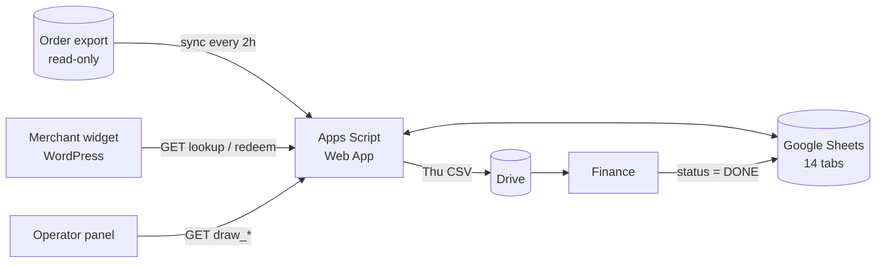

# Gosok Berhadiah — Scratch & Win Campaign Platform

**A Rp 200M digital scratch-card campaign for 10,000 merchants, built end-to-end on Google Sheets + Apps Script with zero infrastructure.**

[Case study page](index.html) · [Demo](demo/) · [Program design](docs/01-program-design.md) · [Technical design](docs/02-technical-design.md)

> Portfolio project by **Faqih**. Campaign design, system design, backend, frontend, and operations tooling.
> All data in this repo and the demo is synthetic. Production IDs and merchant data have been removed.

---

## At a glance

| | |
|---|---|
| **Client** | EDC BukuAgen (payment terminal for small merchants), June 2026 |
| **Goal** | Drive 10,000 device activations in one month within a fixed budget |
| **Mechanic** | Every eligible purchase → digital scratch card(s) → cash commission or grand-prize draw entry |
| **Scale** | 14,000 cards · 6 cash tiers · 17 grand prizes · 2 live draws · 6 weekly payouts |
| **Budget** | Rp 200,000,000, enforced by the prize engine |
| **Stack** | Google Sheets (DB) · Apps Script (API + cron) · Vanilla JS + Canvas (UI) · WordPress/Elementor (hosting) |

## What I built

| Area | Highlights |
|---|---|
| **Program design** | Prize economics that sum exactly to budget; "double chance" 2 cards for the higher-margin Android device; two-wave live draw; weekly payout calendar |
| **Prize engine** | Inventory-weighted random picker + daily quotas so the budget cannot burn out in week 1; every scratch wins something |
| **Transactional API** | Locked, idempotent redeem on a spreadsheet DB; replayed requests return the same prize |
| **Data pipeline** | 2-hourly eligibility sync that never writes to the upstream order export; auto-voids cards on cancelled orders |
| **Merchant UI** | Phone-number lookup, real canvas scratch gesture, confetti, WhatsApp share, personalized deep links |
| **Live draw console** | Operator panel to draw one prize at a time on Instagram Live, gated by livestream attendance |
| **Finance handoff** | Thursday cron builds a per-merchant CSV in Drive; finance marks DONE and the system backfills every row |
| **Test harness** | 8 reserved phone numbers with fixed outcomes that run through production without touching inventory |

## Architecture



Full diagrams (ER, sequence, flowcharts) and 11 design decisions with trade-offs: [docs/02-technical-design.md](docs/02-technical-design.md).

## Try it

The [demo](demo/) runs the real frontend code against an in-browser JavaScript port of the Apps Script backend. No Google account needed.

Test phone numbers (simulated clock starts 20 Jun 2026 10:00 WIB):

| Phone | Shows |
|---|---|
| `8000000001` … `8000000006` | Test mode: fixed cash prize Rp 5K → 200K (re-scratchable) |
| `8000000007` | Draw entry with a `GOSOK-XXXXX` code |
| `8000000008` | Android order: 2 cards |
| `8120000041` | Fresh card, real random prize engine |
| `8120000043` | One card scratched, one waiting |
| `8120000003` | Repeat buyer, everything scratched (prize history) |
| `8120000044` | Paid but not yet confirmed by ops (pending state) |
| `8120000099` | No order |

Also in the demo: operator live-draw console, prize-engine simulator (with vs without daily smoothing), live view of every "sheet", and an API inspector showing each request/response — including idempotent replay.


Run locally:

```bash
python3 -m http.server 8000
```

Then open <http://localhost:8000/> for the case study page, or <http://localhost:8000/demo/> for the demo.

## Deploy (Vercel)

The site is plain static HTML. No build step.

1. In Vercel, **Add New → Project** and import this repository.
2. Framework preset: **Other**. Leave build command and output directory empty (root).
3. Deploy.

What gets published is set by two files:

| File | Purpose |
|---|---|
| `.vercelignore` | Keeps `backend/`, `frontend/`, `docs/`, `README.md` and `LICENSE` out of the deployment, so source and design docs stay private |
| `vercel.json` | `/demo` → `/demo/` redirect (the demo uses relative paths), security headers, caching for images |

Served routes: `/` (case study page), `/img/*`, `/demo/*`.

## Repo layout

```
.
├── index.html   Case study page (site root)
├── img/         Screenshots used by the case study page
├── demo/        Interactive demo (static)
├── backend/     Apps Script source — 11 .gs modules
├── frontend/    Merchant scratch widget + operator draw panel
└── docs/
    ├── 01-program-design.md     Goal, mechanics, prize economics, journey, ops, risks
    └── 02-technical-design.md   Architecture, data model, flows, API, decisions, limits
vercel.json, .vercelignore       Vercel static hosting config
```

## Engineering decisions worth a look

1. **Spreadsheet as a database, on purpose.** Ops and finance could read and correct data directly. A global script lock plus idempotency keys gave the guarantees money handling needs.
2. **GET-only API.** Apps Script turns cross-origin POSTs into bodiless GETs via a 302. Designing around it early avoided a launch-day bug.
3. **Prize decided before the scratch animation.** The server is the only source of truth; the canvas is just the reveal.
4. **Smoothing beats fixed odds.** Weighting by remaining inventory and capping per day keeps the payout on plan without manual tuning. The demo's simulator shows the difference.

## License

MIT — code only. Brand names belong to their owners.
