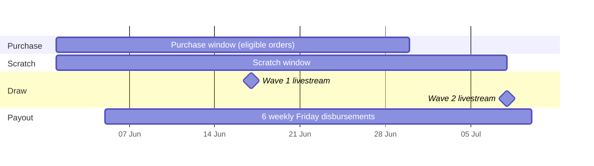
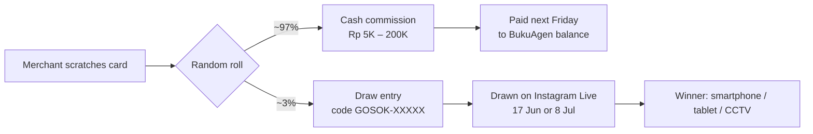
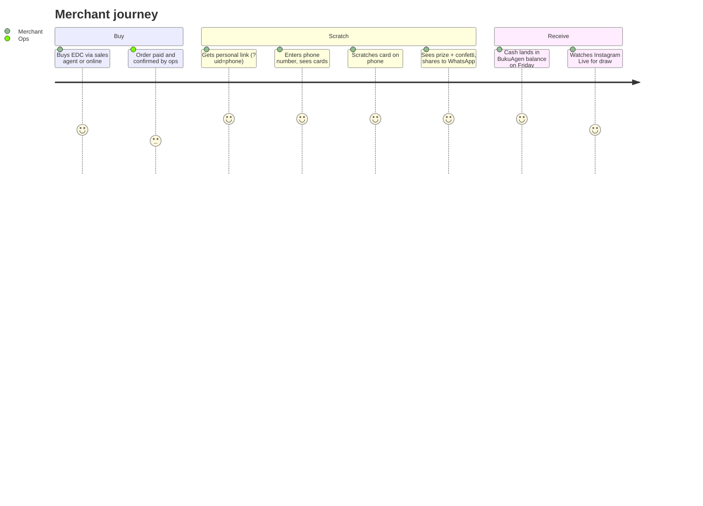
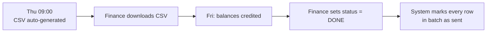

# Program Design — Gosok Berhadiah

> How the campaign was designed as a *program*: goal, mechanics, prize economics, merchant journey, operations and controls.
> For the system that runs it, see [02-technical-design.md](02-technical-design.md).

---

## 1. Problem

EDC BukuAgen (a payment terminal for small merchants) needed a strong push on device purchases during **June 2026**, with a target of **10,000 activations**.

A plain discount would cut margin and train buyers to wait for the next promo. The campaign needed to:

| Need | Why it mattered |
|---|---|
| Reward every buyer | No "I bought and got nothing" complaints |
| Create excitement and shareability | Word of mouth in merchant communities |
| Push the higher-value product | Android device has better unit economics than Saku |
| Hold a fixed budget exactly | Finance approved **Rp 200,000,000**, no overrun |
| Run with almost no engineering | Marketing-owned, no backend team allocated |

## 2. Solution in one line

**Every eligible EDC purchase earns a digital scratch card. Every card wins: a cash commission paid to the merchant's BukuAgen balance, or an entry into a grand-prize draw held live on Instagram.**

## 3. Mechanics

### 3.1 Timeline

| Parameter | Value |
|---|---|
| Purchase window | 1 – 30 Jun 2026 |
| Scratch cutoff | 8 Jul 2026, 11:59 WIB |
| Draw waves | Wave 1 on 17 Jun · Wave 2 on 8 Jul (Instagram Live) |
| Payouts | Every Friday, 6 batches (5 Jun → 10 Jul) |

### 3.2 Eligibility

An order earns cards only when **all** are true:

1. Payment status is `PAID`
2. Ops has confirmed the order (confirmation timestamp exists)
3. Order is not `Cancelled` / `Rejected`
4. Sales code is not on the block list (internal / test accounts)
5. Product is on the allowed list
6. Paid date is inside the purchase window

If an order is cancelled **after** cards were issued, unscratched cards are voided. Already-scratched cards are kept, so a merchant never sees a prize taken back.

### 3.3 Card allocation — the upsell lever

| Product | Cards per order | Purpose |
|---|---|---|
| Saku (all bundles) | 1 | Base reward |
| Android | **2** | "Double chance" — nudges buyers to the higher-value device |

Planned volume: 10,000 Saku × 1 + 2,000 Android × 2 = **14,000 cards**.

### 3.4 Outcomes

Every card wins something. The draw entry keeps a "jackpot" feeling without needing to hand out expensive prizes at random.

## 4. Prize economics

### 4.1 Cash tiers

| Tier | Qty | Subtotal (Rp) | Share of cash cards |
|---|---:|---:|---:|
| Rp 5.000 | 8,666 | 43,330,000 | 63.3% |
| Rp 10.000 | 2,317 | 23,170,000 | 16.9% |
| Rp 20.000 | 2,000 | 40,000,000 | 14.6% |
| Rp 50.000 | 500 | 25,000,000 | 3.7% |
| Rp 100.000 | 150 | 15,000,000 | 1.1% |
| Rp 200.000 | 50 | 10,000,000 | 0.4% |
| **Total cash** | **13,683** | **156,500,000** | |

### 4.2 Grand prizes

| Prize | Qty | Unit value (Rp) | Subtotal (Rp) | Wave 1 | Wave 2 |
|---|---:|---:|---:|---:|---:|
| Smartphone | 2 | 8,000,000 | 16,000,000 | 1 | 1 |
| Tablet | 5 | 3,500,000 | 17,500,000 | 2 | 3 |
| Smart CCTV | 10 | 1,000,000 | 10,000,000 | 5 | 5 |
| **Total** | **17** | | **43,500,000** | **8** | **9** |

**Total pool: Rp 156.5M + Rp 43.5M = Rp 200,000,000** — exactly the approved budget.

### 4.3 Design choices on the numbers

- **Long tail, low floor.** 63% of cards are Rp 5K. Cheap per card, but nobody walks away empty.
- **Visible top tier.** 50 cards of Rp 200K is enough for merchants to see real winners in their community.
- **Expected cash per card ≈ Rp 11.4K.** Known cost per activation, set before launch.
- **Inventory is the hard cap.** The prize engine can never award more of a tier than exists (see technical design §5.4).

### 4.4 Budget pacing

If prizes were drawn purely at random, a busy first week could use up the high tiers and leave late buyers with only Rp 5K cards. That is unfair and bad for late-month sales.

**Fix: daily quotas.** Each tier's inventory is split evenly across the scratch days. Once a tier's daily cap is hit, it is unavailable until tomorrow. If every tier is capped, the scratch becomes a draw entry instead, so the merchant still wins something.

Ops can add budget mid-campaign; one function re-spreads the remaining inventory over the remaining days, and every edit is written to an audit log.

## 5. Merchant journey

Key UX decisions:

| Decision | Reason |
|---|---|
| Login = phone number only | Merchants already know it. No password, no app install |
| Personalized deep link `?uid={phone}#kartu-gosok` | One tap from WhatsApp/CRM message straight to the cards |
| Real scratch gesture on canvas | The physical "gosok" feel is the whole point of the format |
| Payout date shown on every cash prize | Cuts "when do I get paid?" support tickets |
| Draw code shown and copyable | Merchants can check it live during the stream |
| Order-pending state | Explains *why* cards are not there yet, instead of "not found" |

## 6. Live draw design

- Draw entries are split into **two waves** so early buyers do not wait 5 weeks for a result, and late buyers still have a shot.
- Wave 2 got the extra tablet (odd quantity split favors the later wave to sustain end-of-month buying).
- **Attendance gate:** only merchants who registered via a short form for that livestream are eligible to win. This drives live viewership and makes sure winners are reachable.
- Operator runs the draw **one prize at a time** from a dedicated control panel so the host can build suspense on stream.
- Every draw is locked server-side: one wave cannot be drawn twice.

## 7. Operations

### 7.1 Who does what

| Activity | Owner | Cadence | Tool |
|---|---|---|---|
| Order sync and card issuing | System | Every 2 hours | Apps Script trigger |
| Budget top-ups | Campaign owner | As needed | `CASH_PRIZES` sheet + rebalance |
| Disbursement CSV | System | Thursday 09:00 WIB | Drive folder |
| Pay out balances | Finance | Friday | Internal balance tool |
| Mark batch done | Finance | Friday | `DISBURSEMENT_PROGRESS` sheet |
| Live draw | Campaign owner + host | 17 Jun, 8 Jul | Operator panel |
| Prize shipping | Ops | After each draw | `PHYSICAL_DISPATCH` sheet |

### 7.2 Weekly payout loop

Finance works from a file they already know how to process. No new tool to learn, and no automated money movement without a human check.

## 8. Risks and controls

| Risk | Control |
|---|---|
| Budget overrun | Inventory counters + daily quotas; picker cannot exceed `remaining_qty` |
| Double prize on retry / double tap | Idempotency key per scratch; replay returns the same result |
| Two people scratching at once | Server lock serializes every redemption |
| Fake / internal orders | Ops confirmation required + sales-code block list |
| Cancelled orders keeping cards | Sync voids unscratched cards on status change |
| Someone scratching another merchant's card | Card ownership checked against caller's phone |
| Draw fairness disputes | Codes issued at scratch time, Fisher–Yates shuffle, draw done live, one-time lock |
| Launch-day bugs | Dummy mode: 8 test phone numbers with fixed outcomes, no production side effects |
| Reading draw codes aloud | Code alphabet excludes 0/O, 1/I/L |

## 9. Metrics tracked

| Metric | Source |
|---|---|
| Eligible orders / cards issued | `MINT_LOG`, `SCRATCH_CARDS` |
| Scratch rate (cards scratched ÷ issued) | `SCRATCH_CARDS.status` |
| Daily scratches and tier mix | `REDEMPTIONS` + scratch trend dashboard |
| Budget burn vs plan | `CASH_PRIZES.remaining_qty` |
| Android share of orders | Raw order data |
| Payout completion per batch | `DISBURSEMENT_PROGRESS` |
| Livestream registrations per wave | Attendance form |

## 10. Results

<!-- Fill in with numbers you are allowed to share publicly. Keep percentages if absolute numbers are confidential. -->

| Metric | Result |
|---|---|
| Activations vs 10K target | _tbd_ |
| Scratch rate | _tbd_ |
| Android share uplift | _tbd_ |
| Budget used | _tbd_ |
| Payout batches completed on time | _tbd_ |
