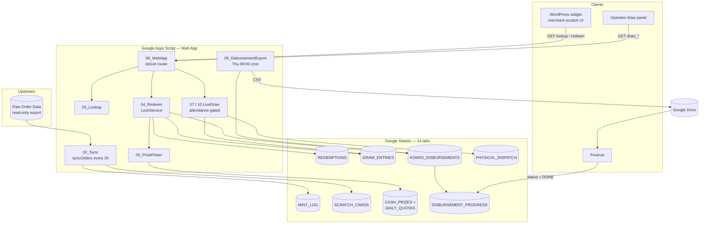
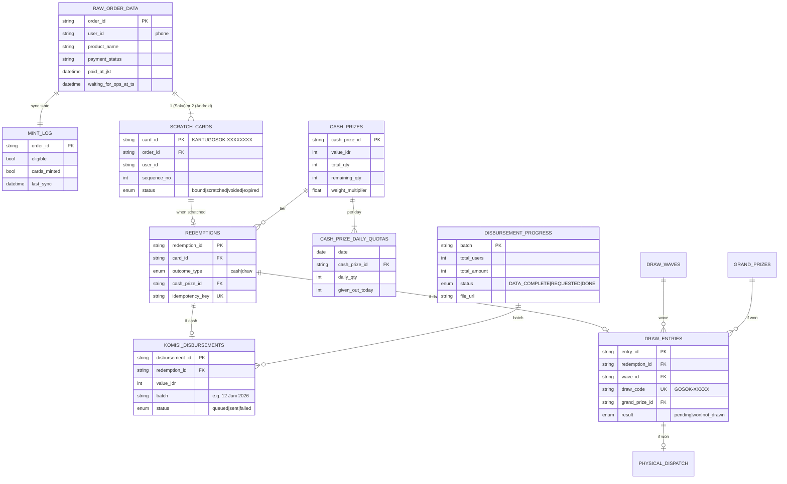
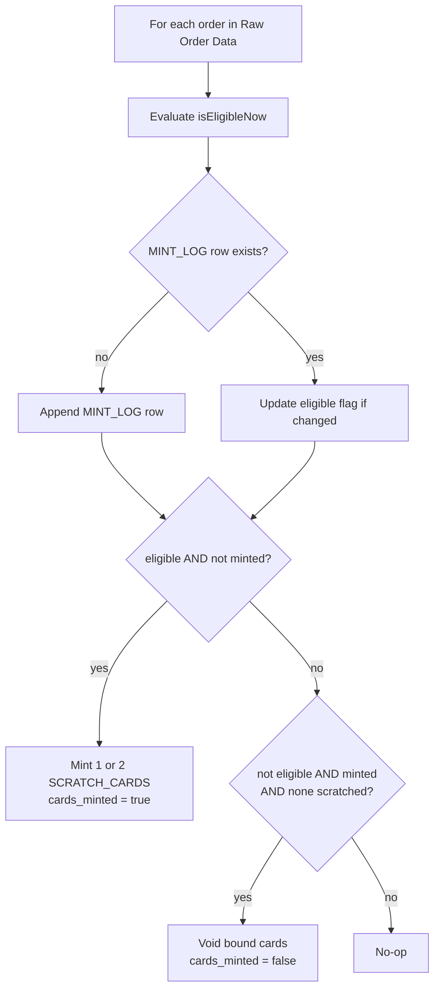
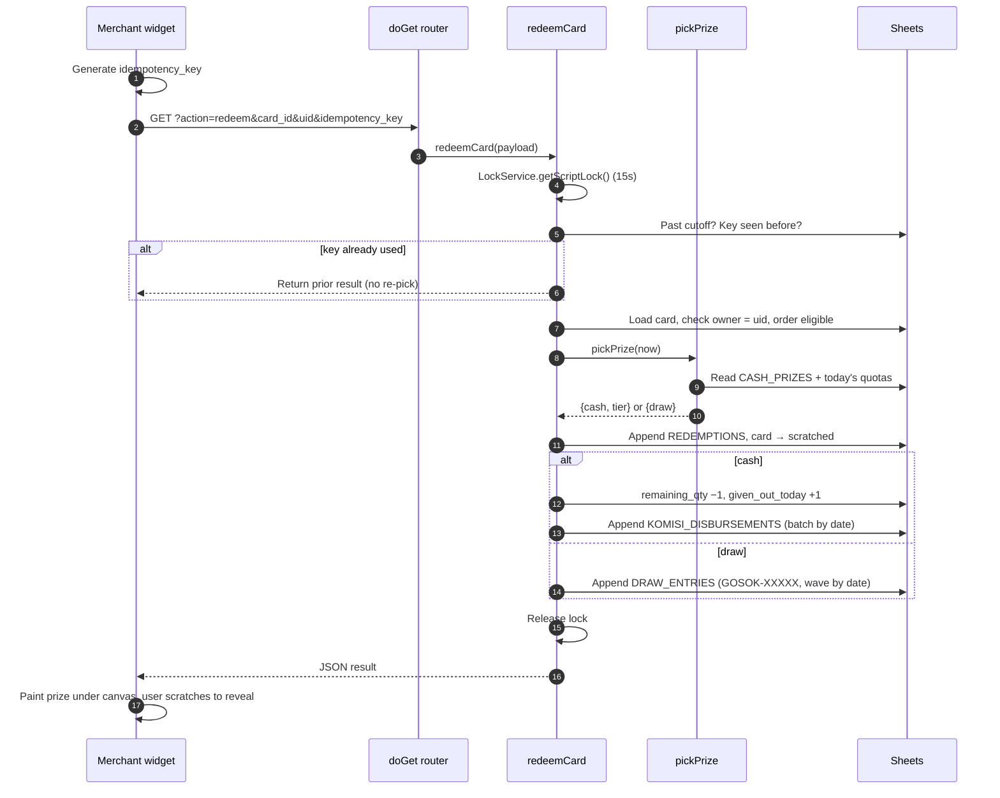
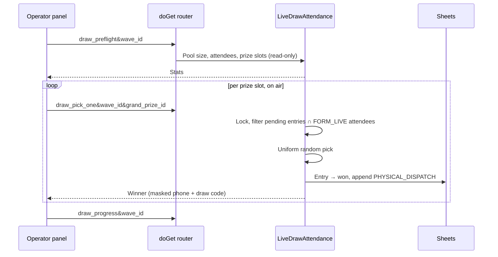
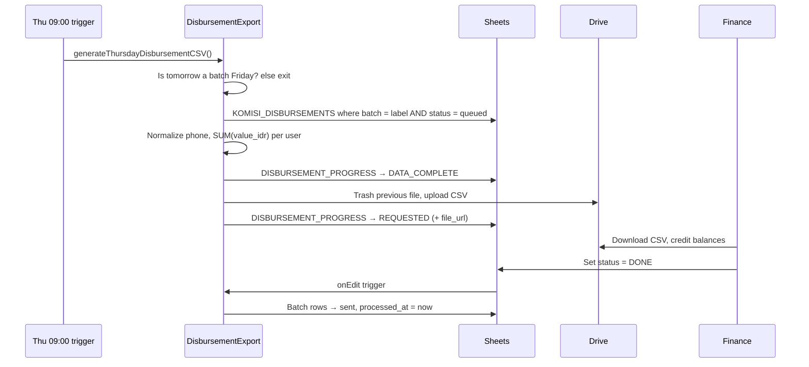

# Technical Design — Gosok Berhadiah

> The system behind the campaign: architecture, data model, core flows, API, and the trade-offs behind each decision.
> For the campaign mechanics and prize economics, see [01-program-design.md](01-program-design.md).

---

## 1. Constraints that shaped the design

| Constraint | Consequence |
|---|---|
| No backend team, no infra budget | Serverless on tools the company already had: Google Sheets + Apps Script |
| Landing page lives on WordPress / Elementor | Frontend is a single self-contained HTML widget |
| Ops, finance and marketing must see and edit data | Database *is* a spreadsheet they can open |
| Upstream order export overwrites its own sheet | Campaign must never write into the raw order sheet |
| Real money and physical prizes | Strong guarantees on inventory, idempotency and auditability |
| Short runway before the June launch | Simple, testable modules; a built-in test mode |

## 2. Architecture



| Layer | Technology | Role |
|---|---|---|
| Database | Google Sheets (one workbook, 14 tabs) | Source of truth, human-editable |
| Backend | Google Apps Script, 11 `.gs` modules | JSON API (Web App) + time triggers |
| Merchant UI | Vanilla JS + `<canvas>` in an Elementor HTML widget | Lookup, scratch, celebration, share |
| Operator UI | Standalone HTML panel | Live draw, one prize at a time |
| Payout handoff | CSV in Google Drive | Finance processes in their own tool |

### Module map

| File | Responsibility |
|---|---|
| `00_Config.gs` | Sheet names, enums, schedules, date/ID helpers |
| `01_SheetIO.gs` | Header-driven row read / append / update / upsert |
| `02_Sync.gs` | Eligibility, card minting, voiding, sheet bootstrap + seeds |
| `03_Lookup.gs` | Merchant state + card enrichment |
| `04_Redeem.gs` | Scratch transaction (locked, idempotent) |
| `05_PrizePicker.gs` | Weighted pick + daily quota smoothing + audit |
| `06_Disbursement.gs` | Legacy direct-API payout (kept as reference, not triggered) |
| `07_LivestreamDraw.gs` | Whole-wave draw |
| `08_WebApp.gs` | `doGet` / `doPost` router |
| `09_DisbursementExport.gs` | Weekly CSV export + finance DONE backfill |
| `10_LiveDrawAttendance.gs` | Attendance-gated, one-by-one live draw |

## 3. Data model



Supporting tabs: `CONFIG` (key/value settings), `GRAND_PRIZES`, `DRAW_WAVES`, `PHYSICAL_DISPATCH`, `CASH_PRIZE_AUDIT`, `DUMMY_CARDS` (test harness), `FORM_LIVE` (livestream attendance form responses).

**Invariant:** columns A–Z of `Raw Order Data` are never written. All campaign state is keyed by `order_id` in separate tabs, so the upstream export can append or replace rows freely.

## 4. Core flows

### 4.1 Eligibility sync and card minting (every 2 hours)



Safe to run any number of times: minting only happens when `cards_minted = false`, and voiding never touches a scratched card.

### 4.2 Scratch (redeem)



The prize is decided **before** the merchant starts scratching. The canvas gesture is pure UX; the server result is already fixed and persisted, so closing the tab mid-scratch loses nothing.

### 4.3 Prize picker

```
eligibleTiers = tiers where remaining_qty > 0 AND today's quota not exhausted
if eligibleTiers is empty           → DRAW   (never deny a scratch)
if random() < draw_pool_ratio (3%)  → DRAW
else pick tier with weight = remaining_qty × weight_multiplier
```

- **Weight by remaining inventory.** As a tier depletes, its odds drop on their own. The campaign ends close to the planned mix without manual tuning.
- **Daily quotas.** `daily_qty = ceil(total_qty / days)`, seeded per (date × tier). Stops a high-traffic day from draining the budget.
- **Rebalancing.** `regenerateDailyQuotas()` spreads remaining inventory over remaining days after a budget change. Every `CASH_PRIZES` edit is written to `CASH_PRIZE_AUDIT`.

Try it: the demo's **Prize simulator** tab runs this exact function with and without smoothing.

### 4.4 Live draw (attendance-gated)



Wave allocation: each grand prize tier is split across waves; odd quantities give the extra unit to wave 2 (Tablet 5 → 2 + 3).

### 4.5 Weekly disbursement



CSV format: `userId,amount,expiryDate,description`, one row per merchant per batch.

## 5. API

Single Web App deployment: `GET https://script.google.com/macros/s/{DEPLOYMENT_ID}/exec?action=...`

| Action | Params | Side effects | Used by |
|---|---|---|---|
| `health` | — | none | monitoring |
| `lookup` | `uid` | none | merchant widget |
| `redeem` | `card_id`, `uid`, `idempotency_key` | writes, locked | merchant widget |
| `draw_preflight` | `wave_id` | none | operator |
| `draw_pick_one` | `wave_id`, `grand_prize_id` | writes, locked | operator |
| `draw_progress` / `draw_winners` | `wave_id` | none | operator |
| `draw_run` | `wave_id` | writes, one-time | operator (bulk fallback) |

### Lookup states

| `state` | Meaning | UI |
|---|---|---|
| `no_order` | Phone has no orders | "Kartu hadiah belum ada" |
| `order_pending` | Orders exist, none eligible yet | "Kartu lagi diproses" |
| `cards_ready` | At least one unscratched card | Card grid |
| `all_scratched` | Everything scratched | Prize history + payout / draw notes |

### Redeem response (cash)

```json
{
  "ok": true,
  "redemption_id": "red_…",
  "card_id": "KARTUGOSOK-A3FX9B2K",
  "outcome_type": "cash",
  "cash_prize": { "value_idr": 10000, "label": "Komisi Agen Rp 10.000" },
  "disbursement": { "status": "queued", "batch": "12 Juni 2026" }
}
```

### Errors

`{ "ok": false, "error": "<code>", "message": "…" }` — codes: `invalid_uid`, `missing_params`, `system_busy`, `campaign_ended`, `card_not_found`, `card_voided`, `card_expired`, `uid_card_mismatch`, `order_not_eligible`, `unknown_action`.

## 6. Key design decisions

| # | Decision | Alternatives considered | Why |
|---|---|---|---|
| 1 | **Google Sheets as the database** | Firestore, Postgres | Zero infra, ops and finance can read and fix data directly, built-in history. Volume (~14K cards) is well within limits |
| 2 | **GET-only API** | POST for writes | Apps Script answers cross-origin POST with a 302 that browsers turn into a GET and drop the body. GET + idempotency key avoids it |
| 3 | **Separate `MINT_LOG` tab** | Extra columns on the raw sheet | First version wrote flags into columns AA–AC of the raw sheet. Moving state out makes the raw sheet strictly read-only, so upstream refreshes can never clash with campaign state |
| 4 | **Global script lock on every write** | Optimistic writes | Picker is read-then-write on inventory. A lock is the only atomicity Apps Script offers. Cost: brief "system busy" at extreme peaks |
| 5 | **Client idempotency key** | Server-side dedupe by card only | Covers network retries and double taps; a replay returns the same prize instead of an error |
| 6 | **Prize decided before the scratch animation** | Decide on reveal | Server stays the only source of truth; the canvas cannot be tampered with to change the prize |
| 7 | **Inventory-weighted + daily-capped picker** | Fixed probabilities | Fixed odds can overshoot a tier's budget. Weighting by what is left converges to the plan; daily caps stop early burn |
| 8 | **CSV handoff to finance** | Direct balance API (`06_Disbursement.gs`) | Keeps a human checkpoint before money moves and fits finance's existing process. The API path is kept in the repo but not triggered |
| 9 | **Attendance-gated, one-by-one draw** | Bulk draw script | Drives livestream viewership, guarantees winners are reachable, and makes the stream watchable |
| 10 | **Unambiguous code alphabet** | Full alphanumeric | Codes are read aloud on stream and typed from screenshots; no 0/O or 1/I/L confusion |
| 11 | **Dummy mode in production** | Separate staging stack | 8 reserved phone numbers with fixed outcomes go through the real deployed API, auto-reset, and never touch real inventory |

## 7. Reliability and limits

| Area | Behavior |
|---|---|
| Concurrency | Lock serializes writes; above ~50 concurrent redeems, some requests get `system_busy` and the UI asks the merchant to retry |
| Sync vs redeem race | Sync only appends cards or voids `bound` ones, so it cannot overwrite a fresh scratch |
| Time zones | All dates are `Asia/Jakarta`, compared as `yyyy-MM-dd` strings; cutoffs built with explicit `+07:00` |
| Config caching | `CONFIG` is read once per execution |
| Schema strictness | Writers follow row-1 headers; adding a column requires adding its header |
| Deployments | Always "new version" on the same deployment, so the widget's URL never changes |

## 8. Testing

- **Dummy mode:** UIDs `8000000001`–`8000000008` cover every outcome (each cash tier, draw entry, 2-card Android) on the live stack.
- **Dry-run helpers:** `previewDisbursementCSVForBatch`, `drawPreflightWithAttendance` read without writing.
- **Re-runnable jobs:** sync, CSV export and quota rebalance are all idempotent.
- **Interactive demo:** [`demo/`](../demo/) ports the backend to the browser so the full flow can be tried without Google services.

## 9. What I would change at larger scale

| Today | At 10× volume |
|---|---|
| Sheets + global lock | Postgres (or Firestore) with row-level transactions on inventory |
| Apps Script Web App | Cloud Run / Functions behind a proper CORS-enabled API |
| Phone number as login | OTP via WhatsApp to stop anyone checking someone else's cards |
| CSV payout handoff | Direct balance API with approval step and reconciliation report |
| Manual address capture for winners | Winner form linked to `PHYSICAL_DISPATCH` |
| Log inspection | Alerts on failed syncs, quota exhaustion and payout lag |
